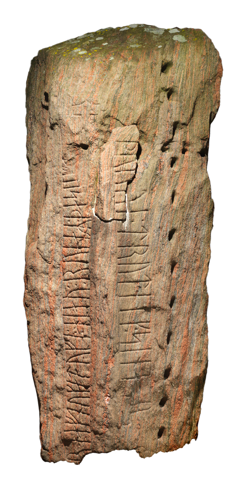

# Page three: Open source

## Which open source project would be useful in my own major, and why?

OS has not bypassed my major, Scandinavian studies, specialized in the Middle Ages in Scandinavia. The project examined below is made for organizations preserving cultural artefacts.

The project <i>K-samsök</i>, developed by the Swedish National Heritage Board, offers museums and archives a framework for publishing data from their collections to researchers worldwide. Such access saves time on travel and bureaucracy and broadens the possibilities of research. An example is <a href="https://runor.raa.se/search">Runor</a>, a database of all known runic inscriptions. It provides transliteration, translation, location and material of each inscription, along with references to literature and other institutions, such as the Rune department of Copenhagen University. Its advanced search can find specific words and filter inscriptions by location or period.

<a href="https://github.com/riksantikvarieambetet/ksamsok">The GitHub statistics</a> of <i>K-samsök</i> indicate a small community: 8 contributors and 1,161 commits, the last on 1 February 2023. The MIT license allows free modification and redistribution. The Swedish National Heritage Board is a body under the Ministry of Culture and is thus funded by the Swedish government.

In conclusion, the project is reliable and very helpful. I use Runor heavily for my master’s thesis. Older rune databases exist as a fallback, but they are not updated and do not unite inscriptions from institutions across Scandinavia, England and Iceland. The project makes my research more precise and swifter.

<b>Sources</b>

- <a href=https://www.raa.se/museer/digital-omstallning-pa-museiomradet/k-samsok-en-digital-dataformedlingstjanst-for-kulturarv/> "‘K-samsök – en digital dataförmedlingstjänst för kulturarv’</a>. 30 September 2026. 
- ‘<a href=https://runor.raa.se/search>Runor</a>’. Accessed 11 November 2026. 
- ‘<a href="https://www.raa.se/hitta-information/runor/vanliga-fragor-runor/">Vanliga frågor om söktjänsten Runor</a>’. 30 October 2020.

